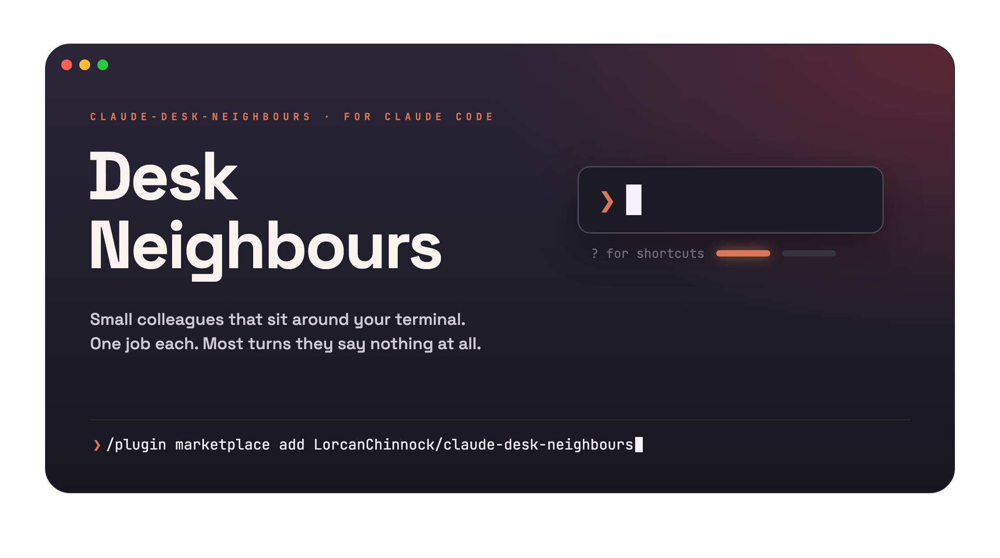
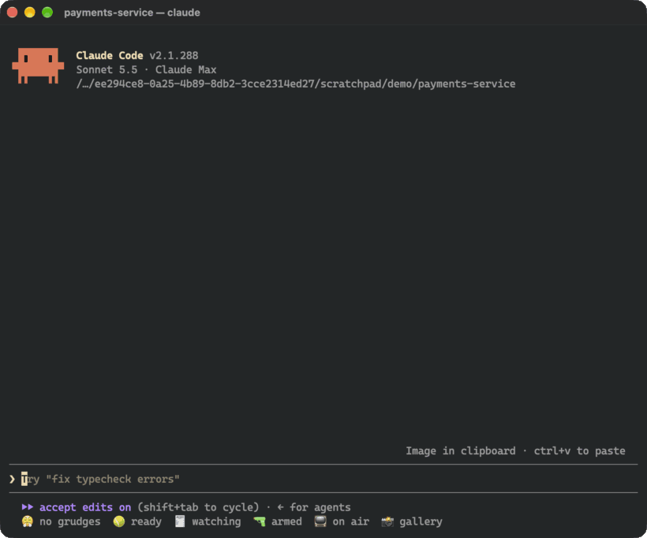

<p align="center">
  
</p>

<p align="center">
  <a href="https://github.com/LorcanChinnock/claude-desk-neighbours/actions/workflows/validate.yml"></a>
  
  <a href="LICENSE"></a>
</p>

<p align="center">
  <a href="#-your-serve">🎾 Your Serve</a> ·
  <a href="#-show--tell">📸 Show & Tell</a> ·
  <a href="#️-whats-next">⏭️ What's Next</a>
</p>

Claude Code does the actual work well. It's the stuff around the work that slips. It asks you something in the
last line of a long reply. The screenshot you pasted three prompts ago is just `[Image #1]`. The session gets so
long that the context fills up. **Desk Neighbours** are three small mods for that kind of thing. They sit in a status row under your prompt and only pipe up, in a
single line above it, when there's something worth saying.

```
/plugin marketplace add LorcanChinnock/claude-desk-neighbours
```

Then install whichever ones you want. They each work on their own, and play nicely together if you have more than one:

```
/plugin install your-serve@claude-desk-neighbours
/plugin install show-and-tell@claude-desk-neighbours
/plugin install whats-next@claude-desk-neighbours
```

---

## 🎾 Your Serve

**A button that has Claude ask you what it needs, so you don't miss the question at the bottom of a long answer.**

- Click `🎾 your serve` in the status row, or run `/your-serve`, and Claude asks each open question in its own
  question picker, one at a time, with the options it would suggest.
- If nothing is waiting on you, Claude says so in one line.
- Press it whenever you like. If Claude is still working, the request waits until the turn is over.

[Everything Your Serve does →](plugins/your-serve)

## 📸 Show & Tell

**Shows a thumbnail as soon as you paste a screenshot, and keeps a gallery of every image in the session.**



- Hit `ctrl+v` with a screenshot on your clipboard and a thumbnail shows up above the prompt straight away,
  before you've sent anything. It disappears when you send, or after 20 seconds.
- Claude's pictures show up the same way: images it reads, screenshots from browser and MCP tools, and anything
  it writes or generates with a command (`playwright screenshot`, a chart script).
- `/gallery` lists them all, newest first, with a big preview. From there you can open one, put `@path` in your
  prompt, copy its path or show it in its folder.
- Pictures only render in terminals that support the kitty graphics protocol, like Ghostty and kitty. Other
  terminals, tmux and the desktop app show the same rows as text.

[Everything Show & Tell does →](plugins/show-and-tell)

## ⏭️ What's Next

**When a session gets long, writes a briefing for the next task and starts it in a fresh context.**

- Click `⏭️ whats next` in the status row, or run `/whats-next [focus]`. Claude writes a self-contained prompt for
  the next task: the goal, where things stand, the files that matter, decisions made, what didn't work, and how to
  check it's done. Add a focus (`/whats-next the auth tests`) to pick the task yourself.
- The briefing opens in a pane. `Start` clears the conversation and sends it as the first prompt, `Edit` clears it
  and puts the briefing in your prompt box, `Copy` copies it, and `Cancel` leaves everything as it was.
- When the context gets to 70% full, the band above the prompt offers a fresh start, once per session.
- If nothing is left to do, it says so in one line.

[Everything What's Next does →](plugins/whats-next)

---

## How they work together

Your Serve and What's Next each add an item to the status row under the prompt, always in that order. Show & Tell
has no status-row item: run `/gallery`, or click `Gallery` in its band, to open its pane; Esc closes it. What's
Next's review pane opens the same way and closes with Esc too.

```
? for shortcuts   🎾 your serve   ⏭️ whats next
```

When a neighbour has something to tell you, it gets a line in the band above the prompt. Long lines wrap instead
of getting cut off. Show & Tell's band buttons don't have digits, so either click them or open the gallery and use
its letter keys. The band clears when you send your next prompt.

## Settings

You can change these in `/config`, or with `/plugin configure <plugin>@claude-desk-neighbours`.

| Plugin | Setting | Default |
|---|---|---|
| `show-and-tell` | Keep new thumbnails above the prompt for (seconds) | 20 |
| `whats-next` | Offer a fresh start when the context is this full (%, 0 turns it off) | 70 |

## What runs in the background

Here's what goes on behind the scenes, so you know before you install:

- **Model calls.** Your Serve's press starts a normal turn on your session's model. What's Next writes its
  briefing with one call on your session's model, over the same conversation, so most of it comes from the prompt
  cache. Show & Tell makes no model calls.
- **Files on disk.** Show & Tell keeps copies of pasted and tool images in `~/.claude/show-and-tell/`, and uses
  `cp`, `sips` or `magick` to copy and convert them. It deletes files older than seven days when a session starts
  (macOS and Linux).
- Nothing is sent anywhere else.

## Requirements

Desk Neighbours are mods, which means they're plugins written against Claude Code's function-hook API. That API
is still in early access. They're built and tested on Claude Code 2.1.289, and since the API can change between
releases, a newer Claude Code might need a newer version of these plugins. If a mod doesn't seem to be doing
anything, `claude --debug` will log why it didn't load. Please
[open an issue](https://github.com/LorcanChinnock/claude-desk-neighbours/issues) and include that line.

## Updating

Third-party marketplaces don't update by themselves unless you turn on auto-update in `/plugin` → Marketplaces.
To update by hand:

```
claude plugin marketplace update claude-desk-neighbours
```

## Developing

Each plugin lives in `plugins/<name>/` and is listed in [`.claude-plugin/marketplace.json`](.claude-plugin/marketplace.json),
where `metadata.pluginRoot` resolves bare sources under `./plugins`.

```
claude plugin validate . --strict          # the marketplace and every plugin
claude plugin test plugins/<name>          # a mod's tests
claude --plugin-dir plugins/<name>         # try one in a session, reloading on save
```

CI runs the first two on every push and pull request. [CHANGELOG.md](CHANGELOG.md) has the history of what's
changed.

## License

[MIT](LICENSE)
